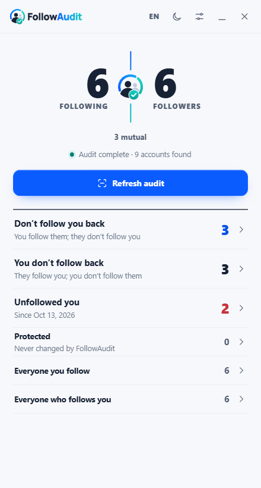
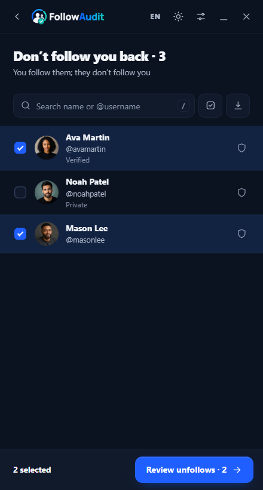
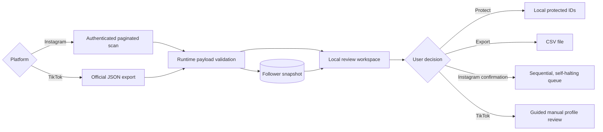

<p align="center">
  <picture>
    <source media="(prefers-color-scheme: dark)" srcset="assets/brand/followaudit-logo-dark.svg">
    
  </picture>
</p>

<p align="center">
  A private, local-first workspace for reviewing who you follow and who follows you on Instagram and TikTok.
  <br>
  Inspect first. Protect what matters. Act only when you are ready.
</p>

<p align="center">
  <a href="https://marquezinii.github.io/follow-audit/"><strong>Open FollowAudit — copy the script</strong></a>
  ·
  <a href="https://marquezinii.github.io/follow-audit/preview.html">Live preview</a>
</p>

<p align="center">
  <a href="https://marquezinii.github.io/follow-audit/">English</a> ·
  <a href="https://marquezinii.github.io/follow-audit/pt-br/">Português</a> ·
  <a href="https://marquezinii.github.io/follow-audit/es/">Español</a> ·
  <a href="https://marquezinii.github.io/follow-audit/fr/">Français</a> ·
  <a href="https://marquezinii.github.io/follow-audit/de/">Deutsch</a>
</p>

<p align="center">
  <a href="https://github.com/marquezinii/follow-audit/actions/workflows/ci.yml"></a>
  <a href="LICENSE"></a>
  
</p>

<p align="center">
  
  
</p>

---

FollowAudit runs entirely inside your browser. On Instagram it scans both sides of your connections and offers an explicit, rate-aware review flow for account actions. On TikTok it reads the follower and following JSON files from your official data export, compares them locally, and keeps all account changes manual.

No account data is sent to a project server. Session credentials are read only when a request needs them and are never stored.

> [!CAUTION]
> Instagram support relies on private web endpoints. They can change without notice, and high-volume account actions may trigger platform limits. TikTok support is read-only and uses only files you explicitly select. This project is not affiliated with or endorsed by Instagram, Meta, TikTok, or ByteDance.

## Features

| Capability | Behavior |
| --- | --- |
| One two-sided audit | A single audit loads Following and Followers once each, page by page, deduplicates, and matches every relationship locally. |
| Report-first side panel | Docks to the right of Instagram or TikTok and opens as an account report: both counts on one axis, mutuals, and ranked segments that open their lists. |
| Who unfollowed you | Each followers audit is compared with the previous snapshot stored in this browser, listing new followers and accounts that left. |
| Focused segments | Don’t follow you back, you don’t follow back, unfollowed you, protected, everyone you follow, everyone who follows you — with instant search (press <kbd>/</kbd>, <kbd>Esc</kbd> to go back). |
| Protected accounts | Stored locally and permanently excluded from action queues. Export and import the list as a JSON backup. |
| Safe action queue | Instagram unfollows and follower removals run one at a time after confirmation, with configurable pauses, a time-left estimate, and an automatic stop on rate limits, refusals, or repeated failures. |
| TikTok, read-only | Imports the official `Follower.json` / `Following.json` export and offers a guided, one-profile-at-a-time manual review. |
| Minimize | Collapse the panel into a small pill and keep browsing while an audit or queue runs. |
| Portable results | Exports the current view as spreadsheet-safe CSV. |
| Five languages | English, Português, Español, Français, Deutsch, plus light and dark themes. |

## FAQ

### How do I see who doesn't follow me back on Instagram?

Copy the script from the [website](https://marquezinii.github.io/follow-audit/), open instagram.com on a computer while logged in, paste it into the browser console and press <kbd>Enter</kbd>. One audit loads who you follow and who follows you, then lists every account that doesn't follow you back. Nothing changes on your account until you confirm.

### Can I see who unfollowed me on Instagram?

Instagram doesn't show this itself. FollowAudit saves your follower list in your browser after each audit and compares the next audit against it, so the first audit has nothing to compare with and every later one lists who left and who is new.

### Does it need my password or an app?

No. It runs in the Instagram tab you already have open and uses that session. There is no app, extension, login, server or analytics.

### Does it work on TikTok?

Yes, read-only: import `Follower.json` and `Following.json` from your official TikTok data export, compare them locally and review each profile manually.

### Can I get banned for using it?

No tool can promise that, and Instagram's terms restrict automated access, so use it at your own risk. FollowAudit is built to be gentle: lists are read page by page, unfollows run one at a time with pauses, are never retried and stop as soon as Instagram pushes back.

## Safety by construction

The destructive path is intentionally slower than the review path:

- unfollow and follower-removal requests are never retried automatically;
- every run requires an explicit confirmation listing the selected accounts;
- protected accounts cannot be selected;
- the queue is sequential, cancellable, and delay-controlled;
- the queue stops itself when Instagram answers with a rate limit, a challenge, or an HTTP 200 refusal body, and after three consecutive failures;
- malformed API payloads fail closed instead of reaching the interface;
- exported CSV cells are escaped against spreadsheet formula injection;
- cookies and CSRF tokens never enter storage, exports, logs, or application state.

## Quick start

1. Open the [FollowAudit website](https://marquezinii.github.io/follow-audit/) and select **Copy script**.
2. Open [Instagram](https://www.instagram.com/) or [TikTok](https://www.tiktok.com/) in a desktop browser.
3. Open Developer Tools (<kbd>F12</kbd>, or <kbd>Cmd</kbd>+<kbd>Option</kbd>+<kbd>J</kbd> on macOS), switch to **Console**, paste the script, and press <kbd>Enter</kbd>. Chrome may ask you to type `allow pasting` the first time.
4. On Instagram, choose a list and run the audit. On TikTok, import the extracted `Follower.json` and `Following.json` files from **Settings and privacy → Account → Download your data** (request JSON format).

Running the script again restores a minimized panel instead of opening a second one. The bundle refuses to start outside `instagram.com` or `tiktok.com`, except on localhost where it enters preview mode; add `?platform=tiktok` to inspect the TikTok state.

## How it works



The interface is a Shadow DOM side panel, isolated from the platform's styles and keyboard shortcuts, that leaves the page beside it usable. The production bundle is a single ~130 KB file with no framework and zero runtime dependencies; the brand font is subset to Latin and embedded as WOFF2.

## Development

Requirements: Node.js 22 or newer and npm.

```bash
git clone https://github.com/marquezinii/follow-audit.git
cd follow-audit
npm ci
npm run dev
```

The local server prints two URLs: the live preview (`/`) with deterministic sample data — it never contacts either platform and cannot perform real actions — and the website (`/index.html`). Set `PORT` to use another port.

### Quality gate

```bash
npm run check
```

Runs ESLint, the Node test suite, TypeScript type checking, website validation (translations, CSP hash, per-language pages, hreflang, structured data, asset references), and the production build. CI runs the same gate plus `npm audit` and verifies that the committed `public/dist.js` matches the sources.

### Project map

```text
src/
├── core.ts          # validation, pagination, queue (halting + ETA), snapshots, CSV
├── instagram.ts     # authenticated Instagram request boundary and refusal detection
├── tiktok.ts        # official export parser and relationship comparison
├── storage.ts       # validated localStorage access, snapshots, protected-list backups
├── preview.ts       # deterministic sample data for local development
├── i18n.ts          # interface strings for five locales
├── main.ts          # panel controller and browser state
├── ui/              # layout template, styles, icons
└── assets/          # brand mark and subset font embedded in the bundle
tests/               # deterministic checks for the critical logic
public/              # GitHub Pages website (English source page, five translated pages generated at build) and the distributable dist.js
assets/brand/        # source logo and mark files
scripts/             # site checks, language pages and sitemap generation, build copy, local static server
```

## Privacy model

| Data | Handling |
| --- | --- |
| Session cookies | Sent by the browser with same-origin requests. FollowAudit reads only your numeric user ID (`ds_user_id`) to build list URLs and key your snapshot; cookies are never persisted. |
| CSRF token | Read immediately before an action request; never exported or logged. |
| Following and follower lists | Held in memory for the current run. Selected TikTok files are never uploaded. |
| Follower snapshot | Follower IDs, usernames, and names from the last followers audit, stored in this browser's `localStorage` per account for change tracking. Clear it any time in **Settings → Clear audit history**. |
| Protected IDs | Stored only in this browser's `localStorage`; exportable as a JSON file you control. |
| Analytics / backend | None. |

## Known constraints

- Instagram can change its internal request contracts at any time.
- A successful HTTP response does not guarantee that the platform will allow continued high-volume activity.
- Instagram audits must run in the same browser profile as the authenticated session.
- Very large follower lists (roughly 30,000+) are not snapshotted, so change tracking is skipped for them.
- TikTok exports can lag behind recent account changes and must be requested in JSON format and extracted before import.
- Closing or reloading the tab ends the active scan or queue.

## Contributing

Read [CONTRIBUTING.md](CONTRIBUTING.md) before opening a pull request. Changes to request handling or destructive actions must include focused tests and preserve the safety properties above. Security-sensitive reports belong in a private [GitHub Security Advisory](https://github.com/marquezinii/follow-audit/security/advisories/new); see [SECURITY.md](SECURITY.md).

## License

Released under the [MIT License](LICENSE). Copyright © 2026 marquezinii. The bundled Manrope font is licensed under the [SIL Open Font License](public/fonts/OFL.txt).
